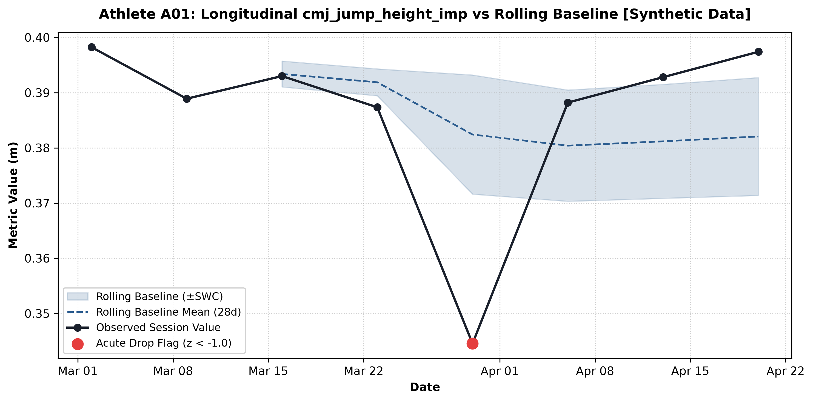
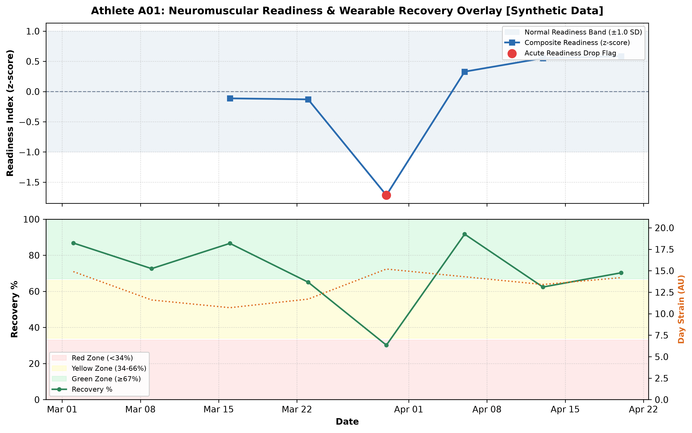

# Project 2: Baselines, Readiness Index, SQL Layer and Longitudinal Reporting (`p2_nmt_reports`)

---

## 1. Research & Practical Problem

In longitudinal athletic monitoring, interpreting single-trial force-plate metrics in isolation is confounded by high inter-individual variability and natural biological noise. A raw jump height of $38\text{ cm}$ may represent peak explosive capacity for one athlete but an acute $-12\%$ neuromuscular deficit for another.

This project implements a modular longitudinal analytics engine that:
1. Contextualizes force-plate metrics against personal rolling 28-day historical baselines (with a strict $\ge 3$-session establishment guardrail).
2. Computes the **Smallest Worthwhile Change** ($\text{SWC} = 0.5 \times \text{SD}_{\text{within}}$, Hopkins, 2004) and **Typical Error** ($\text{TE} = \text{SD} / \sqrt{2}$, Hopkins, 2000) from the athlete's own variability.
3. Formulates a **direction-aware composite neuromuscular readiness index** (McLean et al., 2010; Claudino et al., 2017) so that positive $z$-scores consistently represent better-than-baseline performance across both positive (jump height, RSImod, peak power) and inverted (contact time, contraction time) indicators.
4. Expresses all baseline transformations in a clean, reproducible **DuckDB SQL window function layer** with automated tests proving exact numerical parity with Pandas reference calculations.
5. Implements a **within-athlete linear mixed-effects change model** in Python (`statsmodels`) to isolate session-to-session neuromuscular variance and derive Minimal Detectable Change ($\text{MDC}_{95}$) thresholds.

---

## 2. Mathematical Formulations & Statistical Engine

### 2.1 Rolling Personal Baseline
For an athlete $i$ and metric $m$ across all valid sessions within a backward-looking 28 calendar-day window ($N \ge 3$):
$$\mu_{\text{baseline}} = \frac{1}{N} \sum_{k=1}^N x_k, \quad \sigma_{\text{baseline}} = \sqrt{\frac{1}{N-1} \sum_{k=1}^N (x_k - \mu_{\text{baseline}})^2}$$

- **Smallest Worthwhile Change (SWC)**:
  $$\text{SWC} = 0.5 \times \sigma_{\text{baseline}}$$
- **Typical Error (TE)**:
  $$\text{TE} = \frac{\sigma_{\text{baseline}}}{\sqrt{2}}$$
- **Percentage Change vs Baseline**:
  $$\Delta\% = \frac{x_t - \mu_{\text{baseline}}}{\mu_{\text{baseline}}} \times 100\%$$
- **Direction-Aware Standardized Z-Score**:
  $$z = \begin{cases} +\frac{x_t - \mu_{\text{baseline}}}{\sigma_{\text{baseline}}}, & \text{if } \text{direction} = \text{higher\_is\_better} \\ -\frac{x_t - \mu_{\text{baseline}}}{\sigma_{\text{baseline}}}, & \text{if } \text{direction} = \text{lower\_is\_better} \end{cases}$$

### 2.2 Composite Readiness Index (Heuristic)
Combines standardized z-scores into a linear weighted index:
$$\text{Readiness Index} = w_1 z_{\text{jump\_height}} + w_2 z_{\text{rsimod}} + w_3 z_{\text{peak\_power}}$$
- **Default Weights** (from `config.yaml`): $w_1 = 0.40$ (jump height), $w_2 = 0.35$ (RSImod), $w_3 = 0.25$ (peak power).
- **Heuristic Disclaimer**: *The composite readiness index is an experimental heuristic index for exploratory monitoring, NOT a clinically validated score or medical diagnostic.*

### 2.3 SQL Window Function Layer (DuckDB)
All session aggregations and 28-day rolling window frames are written in standard SQL (`p2_nmt_reports/sql/rolling_baselines.sql`) using explicit window frames:
```sql
AVG(value) OVER (
    PARTITION BY athlete_id, metric, side
    ORDER BY date
    RANGE BETWEEN INTERVAL 28 DAYS PRECEDING AND CURRENT ROW
) AS baseline_mean
```
Parity tests (`tests/test_p2_sql.py`) assert that DuckDB window execution matches Pandas calculations down to $|\Delta| < 10^{-6}$.

### 2.4 Within-Athlete Change Model (Mixed-Effects LMM)
Models longitudinal session-to-session readiness with random intercepts per athlete:
$$\text{Readiness}_{ij} = \beta_0 + \beta_1 z\text{Recovery}_{ij} + \beta_2 z\text{Strain}_{ij} + \beta_3 z\text{Sleep}_{ij} + u_i + \epsilon_{ij}$$
where $u_i \sim \mathcal{N}(0, \sigma_u^2)$ is the between-athlete random intercept and $\epsilon_{ij} \sim \mathcal{N}(0, \sigma_\epsilon^2)$ is the residual within-athlete variation.
- **Minimal Detectable Change**:
  $$\text{SEM} = \sqrt{\sigma_\epsilon^2}, \quad \text{MDC}_{95} = 1.96 \times \sqrt{2} \times \text{SEM}$$

---

## 3. Visualizations

### Longitudinal Metric vs Rolling Baseline Ribbon

*Figure 1: Longitudinal jump height trajectory for Athlete A01 against a rolling 28-day baseline mean and $\pm\text{SWC}$ confidence ribbon (Synthetic Data).*

### Dual-Axis Readiness & Wearable Overlay

*Figure 2: Synchronized dual-axis monitoring card showing Composite Readiness Index ($z$-score) in Panel 1 and Wearable Recovery % / Day Strain in Panel 2 with Red ($<34\%$), Yellow ($34\text{--}66\%$), and Green ($\ge 67\%$) recovery zones (Synthetic Data).*

---

## 4. Reproducibility & Running Tests

To run the complete Project 2 test suite:
```bash
# Run Project 2 unit tests
pytest tests/test_p2_baselines.py tests/test_p2_sql.py tests/test_p2_readiness.py -v

# Run full repository test suite
pytest -v
```

---

## 5. Assumptions, Disclaimers & Limitations

1. **Synthetic Data Disclaimer**: The longitudinal sessions and wearable telemetry used in Project 2 are synthetic monitoring data generated via `shared/synth.py`. They demonstrate pipeline correctness, mathematical accuracy, and SQL window integration, but do NOT constitute empirical research findings.
2. **Heuristic Index**: The composite readiness score is an unvalidated heuristic composite.
3. **Non-Diagnostic Framing**: All flags and alerts are labeled "possible fatigue flags", never diagnoses.
4. **Sample Size & Model Scope**: Longitudinal random-effects models fit on small cohorts ($n \le 15$) have wide confidence intervals on variance components.

---

## 6. AI-Use Transparency & Verification

- **AI Assistance**: Code generation and test scaffolding were generated with AI assistance.
- **Verification Protocols**:
  1. **Analytical Ground Truth Tests**: `test_rolling_baseline_math_and_swc` verifies exact manual formula calculations ($\mu=0.42, \sigma=0.02, \text{SWC}=0.01, z=+1.0$).
  2. **Cross-Engine Parity**: `tests/test_p2_sql.py` executes identical data through DuckDB window functions and Pandas, asserting $|\Delta| < 10^{-6}$ across all metrics.
  3. **Direction Inversion Tests**: `test_direction_aware_z_score` asserts that for `lower_is_better` metrics (e.g. `dj_gct`), shorter contact times yield positive readiness $z$-scores.
